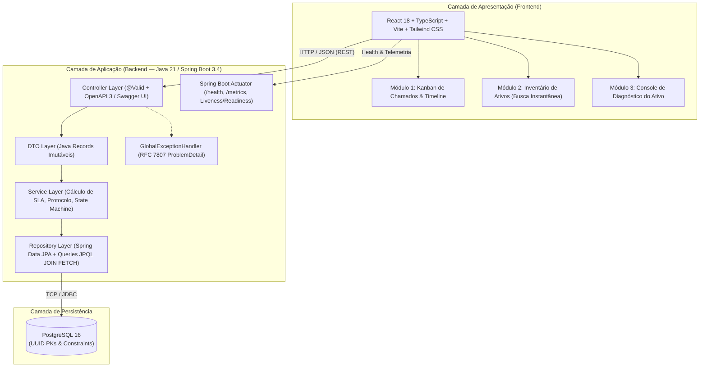
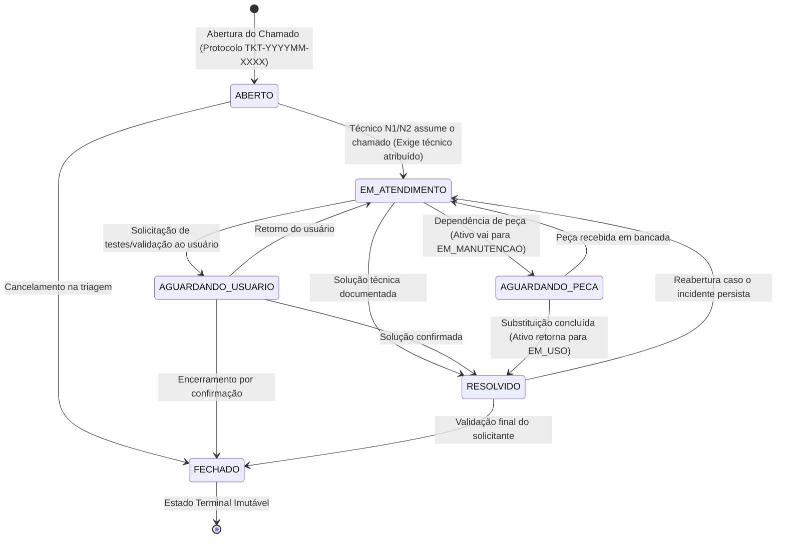
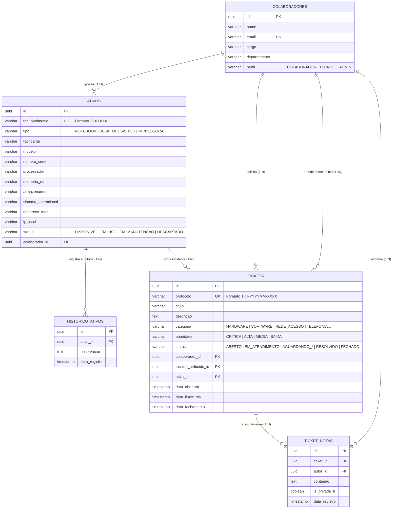

<div align="center">

# 🖥️ DeskOps — Help Desk (ITSM) & Gestão de Ativos de TI (ITAM)

**Plataforma Full-Stack para Operações de Suporte Técnico (N1, N2 e Field Service), Controle de SLA e Rastreabilidade Patrimonial de Hardware.**

[](https://openjdk.org/projects/jdk/21/)
[](https://spring.io/projects/spring-boot)
[](https://www.postgresql.org/)
[](https://react.dev/)
[](https://www.typescriptlang.org/)
[](https://tailwindcss.com/)
[](https://www.docker.com/)
[](https://swagger.io/)

</div>

---

## 📋 Índice

1. [Visão Geral e Problema Resolvido](#-1-visão-geral-e-problema-resolvido)
2. [Arquitetura do Sistema](#-2-arquitetura-do-sistema)
3. [Regras de Domínio, SLA e Máquina de Estados](#-3-regras-de-domínio-sla-e-máquina-de-estados)
4. [Modelagem de Dados Relacional (DER)](#-4-modelagem-de-dados-relacional-der)
5. [Módulos do Dashboard Web](#-5-módulos-do-dashboard-web)
6. [Catálogo de Endpoints REST & RFC 7807](#-6-catálogo-de-endpoints-rest--rfc-7807)
7. [Como Executar o Projeto (Docker & Local)](#-7-como-executar-o-projeto-docker--local)
8. [Testes Automatizados (Backend & Frontend)](#-8-testes-automatizados-backend--frontend)
9. [Estrutura do Repositório](#-9-estrutura-do-repositório)

---

## 🎯 1. Visão Geral e Problema Resolvido

Em ambientes corporativos, equipes de **Suporte Técnico (Service Desk N1/N2)** e **Operações de Infraestrutura** frequentemente enfrentam dois gargalos operacionais críticos:
1. **Chamados Descentralizados:** Solicitações abertas via mensagens informais (WhatsApp, Teams ou e-mail) sem fila priorizada, protocolo único, linha do tempo auditável ou medição de **SLA / MTTR**.
2. **Ativos Invisíveis:** Estações de trabalho, notebooks, impressoras e switches sem identificação patrimonial clara (`TI-XXXXX`), sem vínculo com o colaborador responsável e sem histórico consolidado de manutenções de hardware.

O **DeskOps** unifica **ITSM (IT Service Management)** e **ITAM (IT Asset Management)** em uma única plataforma, vinculando cada incidente técnico diretamente ao patrimônio do equipamento e automatizando o ciclo de vida de atendimento e auditoria de hardware.

---

## 🏗️ 2. Arquitetura do Sistema



### Decisões Técnicas de Destaque
- **Java 21 Moderno:** Uso extensivo de `record` para DTOs imutáveis, *Pattern Matching* em expressões `switch` (cálculo de SLA e validação de estados) e *Text Blocks* para consultas JPQL otimizadas.
- **Prevenção de N+1 no Hibernate:** Relacionamentos configurados com `FetchType.LAZY` por padrão e carregados sob demanda via `JOIN FETCH`.
- **Padronização RFC 7807 (`ProblemDetail`):** Todas as falhas de validação (`400`), recursos ausentes (`404`), conflitos de unicidade (`409`) e violações de invariantes de negócio (`422`) retornam payloads estruturados conforme a especificação **RFC 7807**.
- **Observabilidade Nativa:** Endpoints `/actuator/health` (com verificação ativa de banco de dados e disco) e `/actuator/metrics` integrados ao cabeçalho operacional do Dashboard.

---

## ⚙️ 3. Regras de Domínio, SLA e Máquina de Estados

### 3.1 Matriz de Prioridades e Cálculo Automático de SLA
No momento da abertura do chamado (`data_abertura`), o sistema gera automaticamente o protocolo sequencial no formato **`TKT-YYYYMM-XXXX`** (ex: `TKT-202610-0001`) e calcula a `data_limite_sla`:

| Prioridade | Prazo de SLA | Exemplos de Aplicação no Suporte de TI | Badge Visual |
| :--- | :---: | :--- | :---: |
| **`CRITICA`** | **+2 horas** | Queda de link/VLAN em switch core, parada de servidor ou ERP inacessível | 🔴 Vermelho |
| **`ALTA`** | **+8 horas** | Estação de trabalho com BSOD/desligamento ou falha de impressora departamental | 🟠 Laranja |
| **`MEDIA`** | **+24 horas** | Falha em segundo monitor, instalação de certificado A3 ou ajuste de software | 🟡 Âmbar |
| **`BAIXA`** | **+48 horas** | Configuração de ramal softphone, dúvidas gerais ou solicitações cosméticas | 🟢 Esmeralda |

### 3.2 Máquina de Estados do Chamado (`StatusTicket`)



### 3.3 Invariantes Patrimoniais e Sincronização Automática (ITAM ↔ ITSM)
- **Bloqueio de Equipamento Descartado:** Ativos com status `DESCARTADO` não podem ser associados a colaboradores nem vinculados a novos chamados (`422 Unprocessable Entity`).
- **Sincronização de Manutenção:** Quando um chamado de `HARDWARE` entra em `AGUARDANDO_PECA`, o ativo vinculado tem seu status alterado automaticamente para `EM_MANUTENCAO`. Quando o chamado é `RESOLVIDO` ou `FECHADO`, o ativo retorna automaticamente para `EM_USO` (ou `DISPONIVEL` se estiver no estoque da TI).
- **Trilha de Auditoria (`historico_ativos`):** Toda criação de ativo, transferência de posse entre colaboradores, mudança de status operacional ou vínculo com chamado grava automaticamente um registro cronológico no histórico patrimonial.
- **Notas Públicas vs. Notas Internas de TI (`is_privada_ti`):** A linha do tempo suporta anotações públicas (visíveis ao solicitante) e notas confidenciais de debug restritas aos operadores de TI (`TECNICO` / `ADMIN`).

---

## 🗄️ 4. Modelagem de Dados Relacional (DER)



---

## 💻 5. Módulos do Dashboard Web

A interface em **React + Vite + Tailwind CSS** conta com **KPIs operacionais em tempo real** no topo (Fila Ativa, % de Cumprimento de SLA, MTTR em horas, Total de Ativos em Manutenção e status do Actuator) e 3 módulos principais:

1. **Módulo 1 — Kanban de Chamados:**
   - 6 colunas correspondentes aos estados do chamado (`ABERTO`, `EM_ATENDIMENTO`, `AGUARDANDO_USUARIO`, `AGUARDANDO_PECA`, `RESOLVIDO`, `FECHADO`).
   - Cards com protocolo monoespaçado, badge colorido por prioridade, tag clicável do ativo vinculado (`TI-00142`) e prazo de SLA.
   - Modal interativo de detalhes permitindo atribuir técnico N1/N2, avançar etapas da máquina de estados e adicionar comentários públicos ou notas privadas de TI na *Timeline*.
2. **Módulo 2 — Tabela de Inventário de Ativos:**
   - Busca instantânea por **Tag de Patrimônio** (`TI-00142`), **Endereço IP** (`192.168.10.45`), **Modelo** ou **Colaborador responsável**.
   - Filtros combinados por `StatusAtivo` e `TipoAtivo`, além de modal para cadastro de novos equipamentos.
3. **Módulo 3 — Console de Diagnóstico do Ativo:**
   - Ficha técnica completa da máquina selecionada (Processador, Memória RAM, Armazenamento, Sistema Operacional, IP Local, MAC Address e Colaborador atual).
   - Contador de incidentes de hardware acumulados no ciclo de vida.
   - Listagem de todos os chamados já atrelados àquela máquina e linha do tempo completa da tabela `historico_ativos`.

---

## 🔌 6. Catálogo de Endpoints REST & RFC 7807

A documentação interativa completa pode ser testada diretamente pelo **Swagger UI** em `/swagger-ui/index.html`.

| Método | Rota | Descrição | Códigos HTTP |
| :---: | :--- | :--- | :--- |
| `GET` | `/api/colaboradores` | Lista colaboradores e técnicos (filtro opcional `?perfil=TECNICO`) | `200` |
| `POST` | `/api/colaboradores` | Cadastra novo colaborador ou operador de TI | `201`, `400`, `409` |
| `GET` | `/api/ativos` | Lista e filtra ativos (`?status=`, `?tipo=`, `?busca=`) | `200` |
| `POST` | `/api/ativos` | Cadastra equipamento com Tag `TI-XXXXX` e grava histórico inicial | `201`, `400`, `409`, `422` |
| `PATCH` | `/api/ativos/{id}/status` | Atualiza status ou posse do ativo com auditoria automática | `200`, `404`, `422` |
| `GET` | `/api/ativos/{id}/diagnostico` | Retorna hardware, chamados vinculados e histórico patrimonial | `200`, `404` |
| `GET` | `/api/tickets` | Lista chamados com filtros (`?status=`, `?prioridade=`, `?categoria=`, `?ativoId=`) | `200` |
| `POST` | `/api/tickets` | Abre chamado com protocolo `TKT-YYYYMM-XXXX` e cálculo de SLA | `201`, `400`, `404`, `422` |
| `PATCH` | `/api/tickets/{id}/status` | Executa transição na máquina de estados e sincroniza ativo | `200`, `404`, `422` |
| `GET` | `/api/tickets/{id}/notas` | Lista timeline do chamado (`?incluirPrivadas=true\|false`) | `200`, `404` |
| `POST` | `/api/tickets/{id}/notas` | Adiciona nota pública ou nota técnica interna (`isPrivadaTi`) | `201`, `404`, `422` |
| `GET` | `/api/dashboard/metricas` | Retorna indicadores operacionais (SLA %, MTTR, volumetria) | `200` |
| `GET` | `/actuator/health` | Diagnóstico de saúde da aplicação, PostgreSQL e espaço em disco | `200` |
| `GET` | `/actuator/metrics` | Métricas de latência HTTP e consumo de memória da JVM | `200` |

### Exemplo de Resposta Padronizada de Erro (RFC 7807 `ProblemDetail`)
```json
{
  "type": "https://deskops.local/errors/business-rule-violation",
  "title": "Violação de Regra de Negócio",
  "status": 422,
  "detail": "Para transicionar o chamado para EM_ATENDIMENTO é obrigatório atribuir um técnico responsável.",
  "instance": "/api/tickets/9b2c1a40-6b19-4c9e-9c1a-48d88a123456/status",
  "timestamp": "2026-10-27T21:45:12.410Z"
}
```

---

## 🚀 7. Como Executar o Projeto (Docker & Local)

### Pré-requisitos
- **Docker** e **Docker Compose** (para execução containerizada completa)
- Ou **Java 21+**, **Maven 3.9+** e **Node.js 20+** (para execução local fora de containers)

### Subindo Tudo com 1 Comando (Docker Compose)
```bash
docker compose up -d --build
```
> Ao iniciar pela primeira vez, o componente `DataInitializer` popula automaticamente o banco PostgreSQL 16 com colaboradores, técnicos N1/N2, ativos de TI (`TI-00142` a `TI-00215`) e chamados distribuídos em todas as colunas do Kanban.

### URLs dos Serviços
| Serviço | Endereço |
| :--- | :--- |
| **Dashboard Web (React + Tailwind)** | [http://localhost:5173](http://localhost:5173) |
| **Swagger UI (Documentação Interativa)** | [http://localhost:8081/swagger-ui/index.html](http://localhost:8081/swagger-ui/index.html) |
| **OpenAPI 3.0 Spec (JSON)** | [http://localhost:8081/v3/api-docs](http://localhost:8081/v3/api-docs) |
| **Spring Boot Actuator Health** | [http://localhost:8081/actuator/health](http://localhost:8081/actuator/health) |
| **Spring Boot Actuator Metrics** | [http://localhost:8081/actuator/metrics](http://localhost:8081/actuator/metrics) |
| **PostgreSQL 16 (`deskops_db`)** | `localhost:5434` (`user: deskops` / `password: deskops_password`) |

---

## 🧪 8. Testes Automatizados (Backend & Frontend)

O projeto possui cobertura de testes automatizados tanto na camada de negócios/API (Java) quanto na camada de interface (React):

### Executar Testes do Backend (JUnit 5 + AssertJ + MockMvc)
Valida cálculo de SLA para todas as prioridades, matriz de transição da máquina de estados, geração de protocolo, bloqueio de ativos descartados, visibilidade de notas privadas de TI, diagnóstico de ativos e contratos de erro RFC 7807 (`400`, `404`, `409`, `422`):
```bash
cd backend
mvn test
```

### Executar Testes do Frontend (Vitest + React Testing Library)
Valida renderização das colunas do Kanban, badges semânticos de prioridade e status, busca instantânea na tabela de inventário por IP/Tag, tela de diagnóstico de hardware e exibição de notas técnicas na timeline:
```bash
cd frontend
npm test
```

---

## 📂 9. Estrutura do Repositório

```text
deskops/
├── backend/                                 # API REST em Java 21 + Spring Boot 3.4
│   ├── src/main/java/com/deskops/
│   │   ├── config/                          # OpenAPI Config, CORS e DataInitializer (Seed)
│   │   ├── controller/                      # Colaborador, Ativo, Ticket e Dashboard Controllers
│   │   ├── domain/
│   │   │   ├── entity/                      # Entidades JPA (UUID PK)
│   │   │   └── enums/                       # Enums de Status, Prioridade, Categoria e Perfil
│   │   ├── dto/                             # Java Records imutáveis (*Request / *Response)
│   │   ├── exception/                       # GlobalExceptionHandler (RFC 7807 ProblemDetail)
│   │   ├── repository/                      # Interfaces JpaRepository com JPQL JOIN FETCH
│   │   └── service/                         # Regras de negócio (SLA, Protocolo, State Machine)
│   ├── src/test/java/com/deskops/           # Testes Unitários e de Integração (MockMvc)
│   ├── Dockerfile
│   └── pom.xml
├── frontend/                                # Dashboard em React 18 + TypeScript + Vite + Tailwind
│   ├── src/
│   │   ├── services/api.ts                  # Cliente HTTP integrado à API Spring Boot
│   │   ├── types/deskops.ts                 # Contratos e tipagens TypeScript
│   │   ├── App.tsx                          # Módulos: Kanban, Inventário e Diagnóstico de Ativo
│   │   └── App.test.tsx                     # Suíte de testes em Vitest + Testing Library
│   ├── Dockerfile
│   └── package.json
├── .agents/                                 # Regras arquiteturais e Skills do projeto
├── AGENTS.md                                # Diretrizes de engenharia e domínio
├── especificacao.md                         # Especificação técnica e funcional detalhada
├── docker-compose.yml                       # Orquestração PostgreSQL 16 + Backend + Frontend
└── README.md
```

---

<div align="center">
  <sub>Desenvolvido com foco em excelência operacional para Suporte Técnico (N1/N2), Field Service e Infraestrutura de TI.</sub>
</div>
